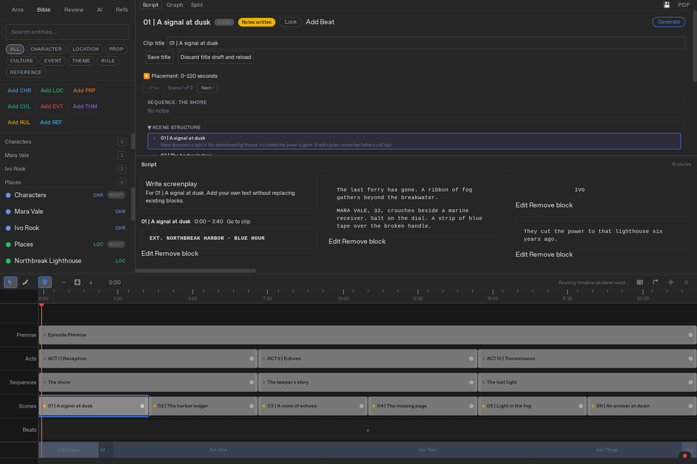

# Eidetic

Shape knowledge and context with clips you can move, resize and split.

Eidetic is a local-first, clip-based knowledge graph. Clips place information and relationships in time, letting you shape what a selected moment draws on and what it produces. Scriptwriting is one application of that model.

The current Tauri desktop workspace brings together a timeline, screenplay editor and story bible. Its Rust backend owns project state, persistence and context assembly.



*Screenplay and timeline in the native app. [More views](docs/reports/native-workflow-acceptance/README.md).*

## Run from source

Use Node.js 24.12.0, Rust 1.92.0 and your platform's Tauri native prerequisites. The build also requires Eidetic's pinned sibling Pumas checkout:

```bash
mkdir -p "$HOME/eidetic-workspace/creative-media"
cd "$HOME/eidetic-workspace/creative-media"
git clone https://github.com/MrScripty/Eidetic.git
cd Eidetic
EIDETIC_FETCH_PUMAS=1 scripts/prepare-pumas-dependency.sh
./launcher.sh --install
./launcher.sh --build
./launcher.sh --run
```

This layout puts Eidetic at `eidetic-workspace/creative-media/Eidetic` and Pumas at `eidetic-workspace/ai-systems/Pumas-Library`, matching Cargo's required relative path. The preparation script clones Pumas there if it is missing and verifies the expected revision. See [dependency setup](docs/dependency-governance.md#external-pumas-dependency) before using an existing checkout.

The launcher installs frontend dependencies and Git hooks. It keeps application state under `.launcher-state/` by default, and `--run` starts the frontend server for the desktop webview. It does not start the old browser application.

For a release binary:

```bash
./launcher.sh --build-release
./launcher.sh --release-smoke
./launcher.sh --run-release
```

The smoke checks backend startup without opening a window. It requires the release build above.

## Current scope

Local project editing, screenplay and story-bible saves, and timeline placement have native acceptance evidence. Real-model generation, embedding retrieval and model lifecycle remain separate integration work.

The main editor timeline remains usable, but the separate native graph and timeline renderers cannot both be started in one process. Restart the app before switching native renderer owners. See [the renderer limitation](docs/reports/native-workflow-acceptance/README.md#native-renderer-limit).

## Develop

```bash
./launcher.sh --test
```

This runs Rust tests and frontend lint, formatting, type checks and tests. See the [documentation index](docs/README.md), [frontend scripts](ui/package.json) and [decomposition baseline](docs/adr/ADR-001-decomposition-baseline.md).

[MIT License](LICENSE).

